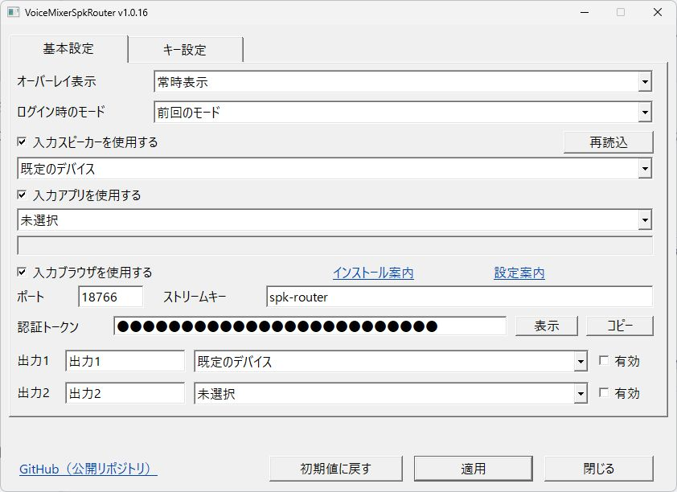
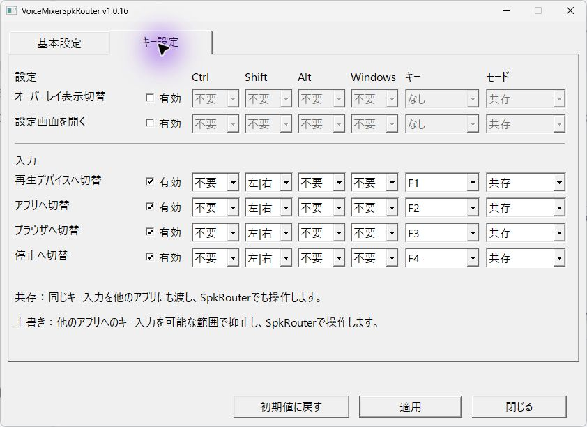
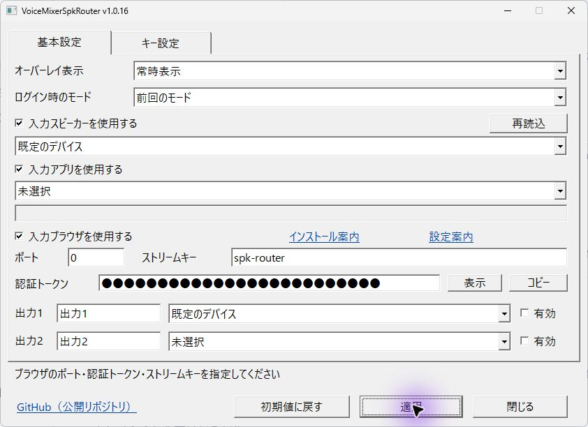
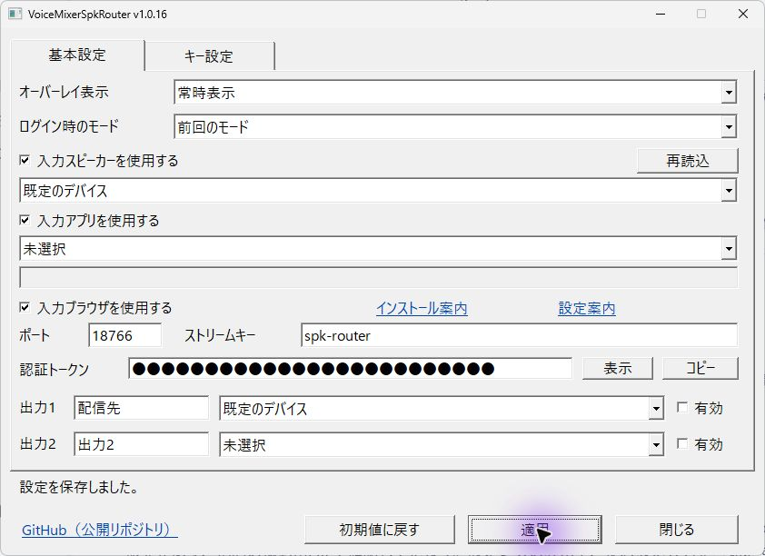
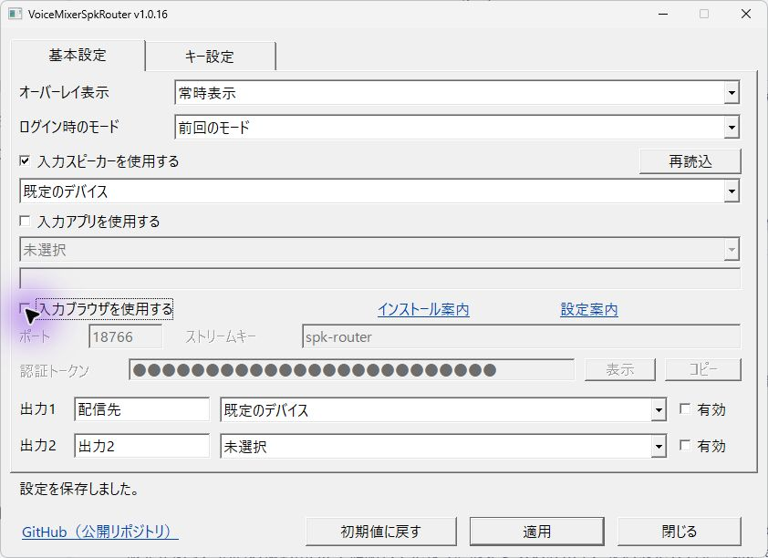

# VoiceMixerSpkRouter

Windowsの再生デバイス・特定アプリ・ブラウザの音声を選び、2台の再生デバイスへ転送する常駐アプリです。

- 再生デバイス・アプリ・ブラウザ・停止の4択から選べます。
- 出力1・2は個別にON/OFFできます。停止を選ぶと取得と転送が止まります。
- 既定キーはShift+F1〜F4です。各キーを変更・無効化でき、共存／上書きも選べます。
- オーバーレイ、トレイ、設定画面を備えます。
- Chrome/Edgeのタブ音声は付属の拡張から取得します。

## こんなときに使えます

- 特定のアプリやブラウザタブの音声を、仮想オーディオデバイスなどを通して配信・録音ソフトへ渡す。
- 普段は聞いていない仮想デバイスの音を、必要なときだけ自分のスピーカーやヘッドホンでモニターする。
- 配信・録音用と自分のモニター用に出力先を分け、必要な出力だけをONにする。

OBSなどの配信・録音ソフトにも音声を選ぶ機能があります。このツールはオーバーレイや割り当てたキーで取得元を切り替えたり、出力先を手元でON/OFFしたりしたいときに使います。

取得元は一度に一つです。配信・録音ソフト側でも転送先の音声を受け取る設定が必要です。

出力をOFFにしても元アプリの音量や再生先は変わりません。自分に聞こえないようにするには、元の再生先も設定してください。

## ダウンロードして使う

[GitHub Releases](https://github.com/KotorinChunChun/VoiceMixerSpkRouter/releases)からWindows x64用のsetup.exeを取得し、実行してください。利用者単位の導入で、Rust・Node.js・.NET・PowerShell 7の追加インストールは不要です。Windows 11 x64が対象です。

初回は設定画面が開き、取得停止・両出力OFFで起動します。同梱の「はじめに.html」に初期設定とブラウザ拡張の導入手順を記載しています。設定は導入先のspk-settings.jsonへ生成し、更新・削除では保持します。

KotorinToys向けの管理契約と配布台帳を同梱しています。[導入・更新・削除と本体連携](docs/kotorintoys-integration.md)に製品IDと配布仕様をまとめています。

## 画面で見る使い方

画像はv1.0.16の撮影用環境です。認証トークンはダミーで、音声転送・外部接続・グローバルキーは動かしていません。

### 1. 基本設定を開く

取得元と出力先を選びます。初回は取得停止・両出力OFFです。転送したい出力だけ「有効」にしてください。

### 2. 切り替えキーを決める

「キー設定」で有効・修飾キー・キー・共存／上書きを変更します。「共存」は他アプリにも同じ入力を渡します。

### 3. 入力エラーを直す

ブラウザの音声を取得するには、有効なポート・認証トークン・ストリームキーが必要です。画像はポートを0にしたため設定を適用できなかった例です。エラーが出たら該当欄を修正します。

### 4. 分かりやすい名前を付けて保存する

出力名は「配信先」など用途に合わせて変更できます。「適用」で保存し、「設定を保存しました。」を確認します。

### 5. 使わない取得元を無効にする

「入力アプリを使用する」「入力ブラウザを使用する」を外すと、対応する欄が無効になります。変更を残す場合は「適用」を押してください。

## 詳しい手順

[操作と仕様](docs/spk-router.md)、[ブラウザ拡張の導入・設定](docs/spk-browser-capture.html)、[開発者ガイド](docs/DEVELOPERS_GUIDE.md)を参照してください。

MSTSC前景のキー検知に対応しますが、OSが保護する操作や権限の異なるウィンドウまで抑止する保証はありません。実接続・物理キーと自動試験の範囲は[検証記録](dev/testing/spk-router-results.md)で区別します。
